<p align="center">
  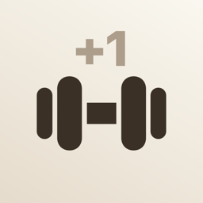
</p>

<h1 align="center">One More</h1>

<p align="center">
  在 Apple Watch 上记录健身房力量训练：组间休息时抬腕记一下，练完在 iPhone 上看历史、走势和个人最佳。<br>
  <sub>A strength-training logger for Apple Watch &amp; iPhone · SwiftUI · SwiftData · HealthKit · 中文界面</sub>
</p>

<p align="center">
  
  
  
  
</p>

---

## 截图

### Apple Watch

| 首页 | 训练中 | 记一组 | 组间休息 | 训练总结 |
|:---:|:---:|:---:|:---:|:---:|
| 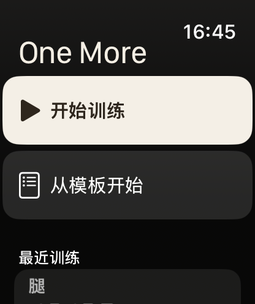 | 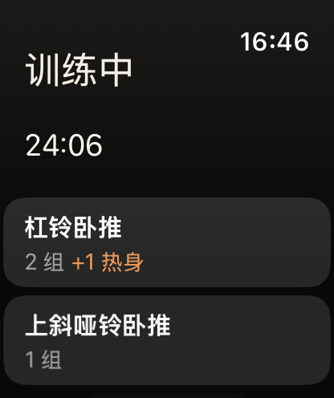 | 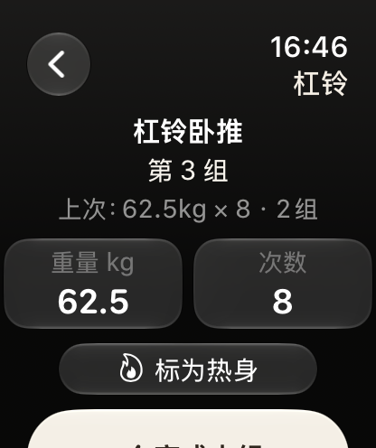 | 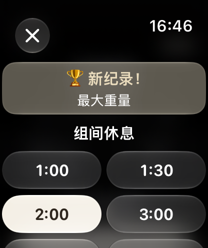 | 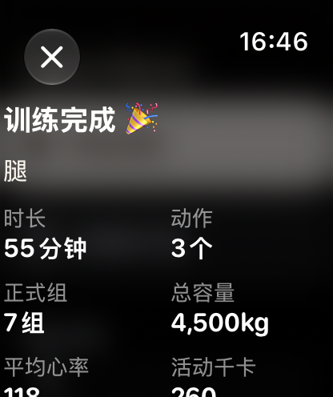 |

### iPhone

| 训练记录 + 热力图 | 训练详情 | 动作走势与个人最佳 | 动作库 |
|:---:|:---:|:---:|:---:|
| 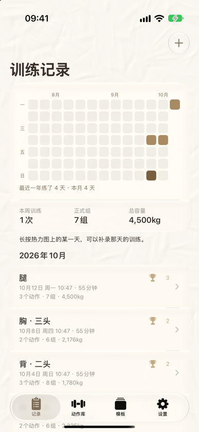 | 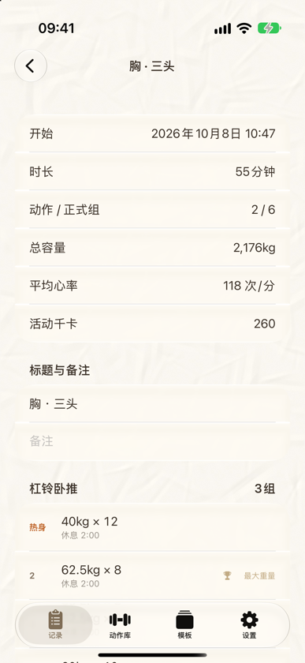 | 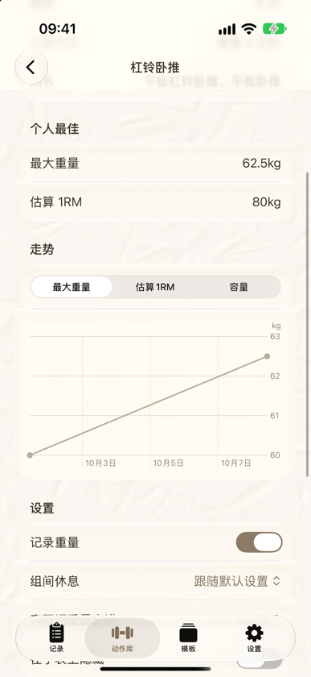 | 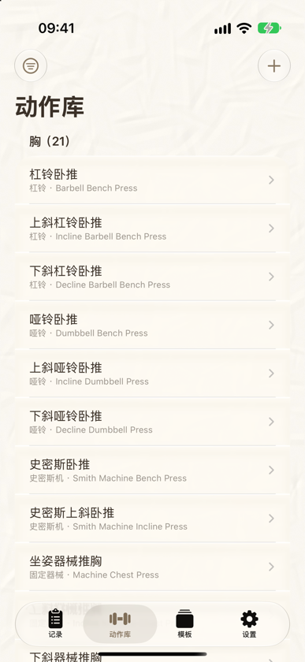 |

| 在手机上训练 | 记组后选休息时间 | 训练模板 |
|:---:|:---:|:---:|
| 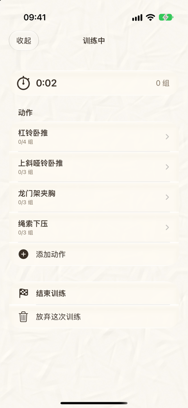 | 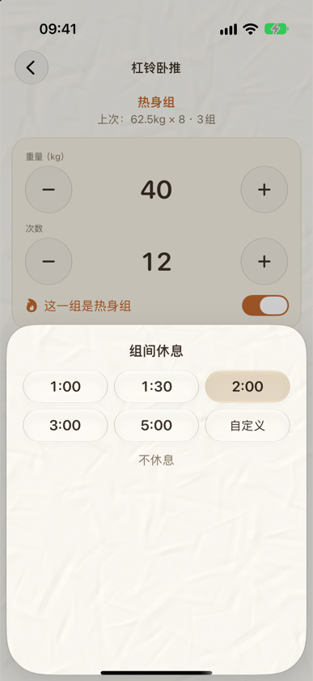 | 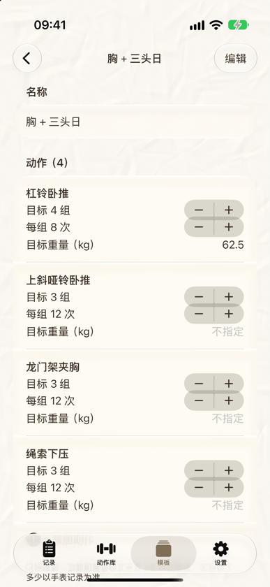 |

---

## 功能

### ⌚️ 手表：组间休息时快速记录
- **内置 208 个健身房常用动作**：覆盖胸、背、肩、二头、三头、前臂、腿、臀、小腿、核心、全身和有氧器械，带常用别名（比如“绳索 = 龙门架 / 拉力器”）。
- **搜索很快**：支持中文、英文和**拼音首字母**，比如输入 `gwxl` 就能找到“高位下拉”；也可以按部位 → 器材浏览，或者从“最近用过”里选。
- **一按完成一组**：表冠调重量和次数，每转一格跳一档（杠铃 2.5kg，哑铃和器械 1kg，可以按动作单独设置）。支持“双指互点”的手表（Series 9 及以后、Ultra 2 及以后）还可以用手势完成。
- **自动预填**：按“本次上一组 → 上次训练同一组 → 模板目标”的顺序带出数值，多数时候不用调，直接点“完成本组”。
- **组间休息计时**：记完一组后弹出快捷时长（1:00 / 1:30 / 2:00 / 3:00 / 5:00 / 自定义），点一下开始倒计时，剩 10 秒轻震，结束时连震。**每个动作会记住你上次选的休息时长**。
- **个人最佳提醒**：打破最大重量、估算 1RM、最多次数或最长时间时，会震动并提示 🏆。
- **热身组、RPE、备注**：热身组不计入组数、容量和个人最佳。
- **支持多种记录方式**：重量×次数、自重（可选附加重量）、辅助器械、计时（平板支撑）、负重计时（农夫行走）、有氧（时长 + 距离）。
- **接入苹果健康**：以“传统力量训练”写入健康，记录心率和卡路里，计入活动圆环。训练期间抬腕会直接回到 app，app 意外退出后也能恢复训练。

### 📱 iPhone：回顾、规划，也能直接练
- **训练热力图**：像代码提交记录一样，颜色深浅表示当天练了多少组；可以左右滑动查看一年。点一下看当天详情，**长按某一天可以补录那天的训练**。
- **训练记录**：每次训练的动作、每一组、休息时长和个人最佳；可以修改、补记或删除某一组，也可以存为模板。
- **动作库**：每个动作都有个人最佳和走势图（最大重量 / 估算 1RM / 容量）。可以设置是否记录重量、默认休息时长和表冠步进；也可以新建自定义动作。
- **训练模板**：提前安排好“胸 + 三头日”这类计划，在手表或手机上一点就开始。
- **在手机上训练**：和手表一样的记录流程，包括预填、休息倒计时（后台时用通知提醒）和破纪录提示。
- **备份**：导出 JSON（可以恢复）或 CSV（可以用 Excel 打开）。

### 🔄 同步与隐私
- 手表和 iPhone 通过 **WatchConnectivity** 直接同步，**不需要 iCloud，也不需要服务器**。两边都能离线使用，按“后写者胜”的规则合并。
- 所有数据都只保存在你自己的设备上，不收集、不上传。
- **免费 Apple ID 就能装到自己的手表和手机上**，不需要付费开发者账号。

### 🎨 设计
米白色的“揉皱纸张”背景，配上 iOS 26 / watchOS 26 的 Liquid Glass 玻璃材质和柔和的米色主题，支持深色模式。

---

## 安装到自己的设备

### 需要准备
- 一台 Mac，安装 **Xcode 26** 或更新版本（App Store 免费下载）
- iPhone：**iOS 26+**；Apple Watch：**watchOS 26+**
- 一个 Apple ID（免费的就行）
- [XcodeGen](https://github.com/yonaskolb/XcodeGen)，用来生成 Xcode 工程：

```bash
brew install xcodegen
```

### 1. 生成 Xcode 工程

```bash
git clone https://github.com/Susuyyyy1/OneMore.git
```

```bash
cd OneMore && ./generate.sh && open OneMore.xcodeproj
```

### 2. 配置签名
1. 打开 Xcode → Settings → Accounts，登录 Apple ID，会出现一个 “Personal Team”。
2. 编辑 `Config/Signing.xcconfig`：
   - `BUNDLE_ID_PREFIX`：改成**你自己的**前缀，比如 `com.zhangsan`。bundle ID 必须全世界唯一。
   - `ONEMORE_TEAM`：填你的 Team ID。如果不知道，先在 Xcode 里给 `OneMore` 和 `OneMoreWatch` 两个 target 的 Signing & Capabilities 选好 Team，再运行下面这条命令查出来：

```bash
grep -m1 -o 'DEVELOPMENT_TEAM = [A-Z0-9]*' OneMore.xcodeproj/project.pbxproj
```

3. 改完重新运行 `./generate.sh`。

### 3. 打开开发者模式
- iPhone：设置 → 隐私与安全性 → 开发者模式 → 打开，然后重启
- Apple Watch：设置 → 隐私与安全性 → 开发者模式 → 打开，然后重启。如果找不到这个选项，先把 iPhone 用线连到 Mac，让 Xcode 识别一次

### 4. 一键安装
iPhone 用数据线连上 Mac 并解锁，手表戴着、解锁、放在手机旁边，然后运行：

```bash
./install.sh
```

脚本会编译并分别安装到 iPhone 和手表上。它直接把 app 装进手表，不经过 Xcode 调试连接，也不经过 iPhone 上的 Watch app，这两条路经常卡住。也可以只装其中一个：`./install.sh phone` 或 `./install.sh watch`。

第一次打开时如果提示“不受信任的开发者”：在 iPhone 上进入 设置 → 通用 → VPN与设备管理 → 你的 Apple ID → 信任。

> **免费账号的限制**：装上的 app 每 **7 天**过期，到期后重新运行一次 `./install.sh` 就行，**数据会保留**（不要删除 app，删除会清空数据）。没有 iCloud，建议定期在 iPhone 端“设置 → 备份”里导出 JSON。

---

## 使用

**手表**
1. 打开 One More → **开始训练**（或“从模板开始”）。第一次会请求健康权限，建议允许。
2. **添加动作**：搜索（中文 / 拼音首字母 / 英文）、最近用过，或者按部位找。
3. 点重量或次数（出现框线）→ 转表冠调整 → **完成本组**。热身组先点“标为热身”。
4. 弹出休息时长后点一下开始倒计时，时间到会震动提醒。
5. **结束训练**：查看总结，可以加备注、存为模板。训练记录会自动同步到 iPhone。

**iPhone**
- 右上角 **＋**：开始训练、从模板开始、补录训练；**长按热力图上的某一天**也可以补录。
- 点开某次训练，可以修改、补记或删除某一组。
- “动作库”里可以查看走势、调整每个动作的设置、新建自定义动作。
- “设置”里可以切换 kg / lb、编辑休息快捷时长、导出或恢复备份。

**记录约定**：哑铃记**单只**的重量；杠铃记**含杆总重量**；单侧动作记**每侧**的次数。

---

## 开发

### 项目结构
```
project.yml            XcodeGen 配置（不要直接改 .xcodeproj）
Config/                签名配置
Shared/                手表和 iPhone 共用
  Models/              SwiftData 模型、数据库与内置动作库导入
  Logic/               训练逻辑：个人最佳、预填、统计、搜索、WorkoutOps（记组等操作）
  Sync/                WatchConnectivity 同步、DTO、合并规则
  Seed/exercises.json  内置动作库（208 个，修改后提高 version，已安装的 app 会增量更新）
  Theme.swift          全部配色
Watch/                 手表 app：训练会话（HealthKit）、休息计时、界面
iOS/                   iPhone app：记录、热力图、动作库、模板、设置、手机训练、备份
Tests/                 单元测试
tools/                 图标和纸张背景生成脚本
```


### 同步机制
- 单条记录（训练、模板、动作设置）用 `transferUserInfo` 发送，系统会排队保证送达，对方 app 没开也能收到；每次启动还会补发上次之后改动过的记录。
- 首次配对、手动“全量同步”和从备份恢复后，用 `transferFile` 发送全量数据。
- 合并规则：按 `updatedAt` 后写者胜，删除用 `isRemoved` 标记。设置以 iPhone 为准，通过 `updateApplicationContext` 发给手表。

---

## 致谢
- 动作名称参考了 [free-exercise-db](https://github.com/yuhonas/free-exercise-db)、ExRx 以及中文健身社区的常用叫法。
- 工程由 [XcodeGen](https://github.com/yonaskolb/XcodeGen) 生成。

## 许可证
[MIT](LICENSE)
